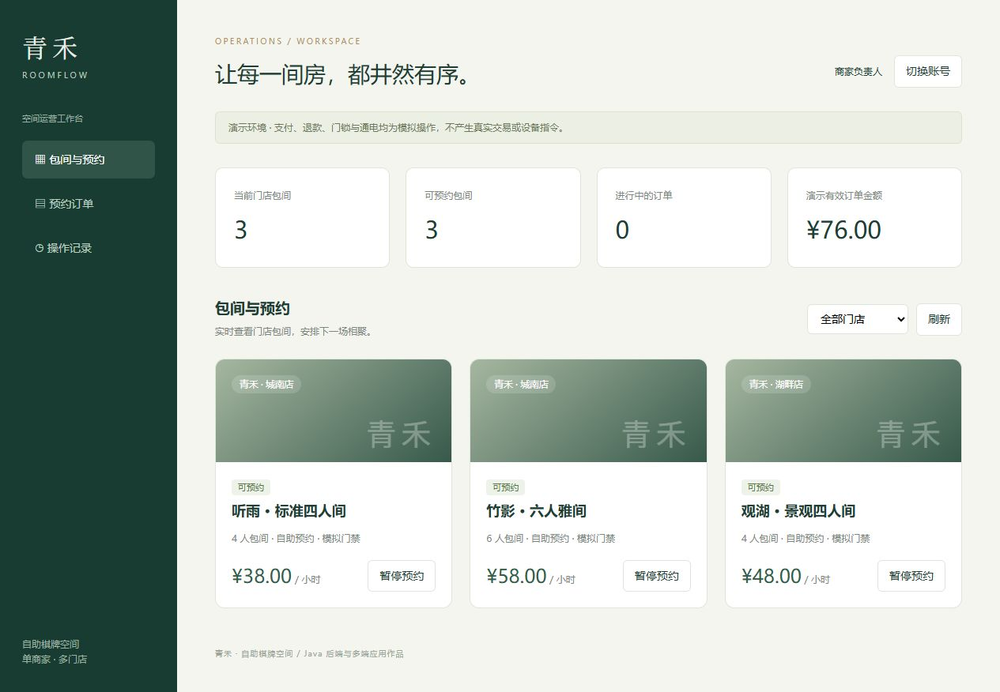

# RoomFlow · Self-Service Mahjong Room Management

[简体中文](README.md) | **English**

A Java-backed portfolio application for one merchant operating multiple self-service mahjong venues, with a customer WeChat mini-program, a staff mini-program interface and a PC operations dashboard.



## Implemented Demo

- Store filtering, room availability, time-slot reservations and order management.
- Simulated payment, cancellation/refund, door opening and end-of-use device shutdown.
- Cleaning and maintenance states controlled by authorized staff.
- Customer ownership checks, store-scoped managers and merchant-wide operations.
- Transactional room locking to prevent overlapping bookings, request idempotency and pending-order expiration.
- Merchant audit logs and demo order totals.

The customer and staff interfaces share a native WeChat mini-program project. Role permissions are enforced by the backend.

## Run

Requirements: JDK 8 and Maven. The demo uses a local H2 file database.

```powershell
cd backend
mvn clean package
cd ..
./start.ps1
```

Open http://localhost:8091 and choose a demo role. Demo accounts are passwordless and must not be exposed as production authentication.

Import `miniprogram` into WeChat Developer Tools and configure the API address in `app.js`. The supplied tourist AppID requires verification in your Developer Tools environment. Real-device operation requires a reachable backend; production requires your own AppID, approved HTTPS domain and WeChat login.

The server binds to localhost by default. Configure `SERVER_ADDRESS` for trusted LAN testing; do not expose passwordless demo administrator login to the public internet.

## Verification

Run `mvn test` in `backend`. Nine backend business tests passed, including lifecycle, overlapping reservations, permissions, idempotency, expiration and concurrent booking. PC and mini-program JavaScript syntax checks passed. Mini-program Developer Tools and real-device acceptance testing remain pending.

The PC browser flow was verified from reservation through simulated payment, opening, completion and staff cleaning confirmation.

## Scope

This is the first runnable stage of a commercial-scenario portfolio project, not a production-ready commercial release. Payments, refunds, locks and power control are simulated. No money or real device command is sent.

Real authentication, payment/refund reconciliation, device acknowledgements, automatic session expiry, booking extensions, memberships, coupons, production operations and store configuration screens are not implemented. Disabling `ROOMFLOW_DEMO` disables demo login and simulated payment/device actions.

Stack: Java 8, Spring Boot 2.7.18, JDBC, H2, native browser HTML/CSS/JavaScript and native WeChat mini-program source. Production database migration and current framework selection require separate evaluation.

[Commercial roadmap (Chinese)](docs/PRODUCT.md)
