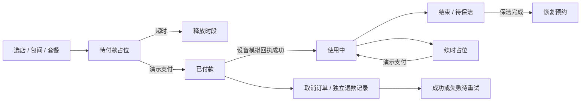

# RoomFlow · 青禾自助棋牌空间

**简体中文** | [English](README.en.md)

**单商家、多门店的自助棋牌室经营系统：Java 后端 + 用户/管理员微信小程序 + PC 工作台。**

当前为 v0.2 商业场景模拟验收版。经营功能与异常处理可以在本地体验；收款、退款、门锁与通电使用模拟流程。真实服务、微信真机、MySQL 和公网部署仍需联调，不能当作完整生产商用版交付。


## 已实现功能

| 业务模块 | 当前实现 |
| --- | --- |
| 门店与包间 | 新增/编辑、多门店筛选、上下架、维护、营业时间 |
| 价格与预约 | 小时计价、指定包间套餐、价格快照、半小时递增、并发冲突检查 |
| 保洁与入场 | 提前入场与保洁缓冲都占用预约时段，结束后待保洁，管理员确认恢复 |
| 续时 | 检查后续预约，先创建5分钟有效的续时占位，演示支付后延长时间 |
| 取消与退款 | 自助取消截止时间、员工处理、独立退款记录、失败状态、重试与模拟对账 |
| 设备与异常 | 指令/回执记录、模拟离线、失败时不误报开门成功、重试、告警 |
| 自动任务 | 30秒周期处理待付款过期、到时结束、未到店和结束前10分钟站内提醒 |
| 人员与权限 | 用户订单隔离、管理员门店范围、员工账号、密码散列、停用/改店撤销会话 |
| 微信身份 | 服务端 code2Session 登录代码、用户默认角色、负责人绑定员工微信；未配置时禁用 |
| 管理与交付 | 订单备注、流水记录、健康检查、Flyway迁移、H2备份与隔离恢复测试、部署模板 |

PC 和小程序都有经营入口；用户与管理员小程序共用工程，由服务端身份决定操作权限。小程序只有源码与语法检查，尚未在微信开发者工具/真机完成验收。

## 业务闭环



- 默认15分钟保洁缓冲、0分钟提前入场，商家可配置。相邻订单必须满足双方的有效占用范围。
- 保留订单的计价与缓冲规则快照；调整价格不会改变已有订单金额，续时按原小时价计算。
- 待付款15分钟过期；续时占位5分钟过期；累计使用最多12小时。
- 模拟设备失败时保持原订单/房间状态，记录告警；收到成功回执后才改变使用状态。
- 自动结束失败最多重试3次，之后保留记录供人工现场处理；模拟退款成功与订单取消是两个独立状态。
- 当前为单实例实现，会话存放内存；服务重启需重新登录。尚不支持跨实例共享会话和分布式调度。

## 页面实拍

[套餐与续时订单](docs/images/pc-orders.png) · [经营配置](docs/images/pc-configuration.png) · [账务与设备回执](docs/images/pc-finance.png)

## 本地运行

需要 JDK 8、Maven。默认 H2 文件数据库，无需安装 MySQL。

```powershell
cd backend
mvn clean package
cd ..
./start.ps1
```

访问 http://127.0.0.1:8091，选择演示角色；管理员配置门店、包间和套餐，用户体验预约流程。演示账号没有密码，不要将演示入口开放到公网。

正式员工密码登录需要通过环境变量 OWNER_USERNAME / OWNER_PASSWORD 首次初始化负责人。配置清单见 [.env.example](.env.example)，该文件不会自动加载；请使用进程环境变量或部署工具注入。

关闭 ROOMFLOW_DEMO 后禁用演示身份和模拟资金/设备操作。真实支付与设备未配置实现，不会转为偷偷模拟成功。

### 小程序

微信开发者工具导入 `miniprogram`，设置自己的 AppID 或可用的测试 AppID。在 `app.js` 配置后端地址。默认服务仅监听本机；可信局域网测试需另行配置 SERVER_ADDRESS。正式微信登录还需服务端 WECHAT_APPID / WECHAT_SECRET，不把 AppSecret 或 session_key 发给前端。

## 验证与部署

```powershell
cd backend
mvn test
```

测试覆盖预约并发、缓冲、套餐快照、续时HTTP流程、失败退款、设备失败/重试、自动结束、未到店、权限与撤销、微信模拟响应及备份恢复。实际结果与限制见 [验收记录](docs/VALIDATION.md)。

[配置、部署与备份说明](docs/OPERATIONS.md) · [功能状态与外部接入清单](docs/PRODUCT.md)

提供 Dockerfile、compose.yml、Nginx HTTPS模板、MySQL备份脚本及健康检查脚本。模板不等于已经完成容器、公网部署或微信审核。

## 技术与目录

Java 8 / Spring Boot 2.7.18 / JDBC / Flyway / H2 / MySQL驱动；原生 HTML/CSS/JavaScript 工作台和原生 WXML/WXSS/JavaScript 小程序。

- `backend`：业务、权限、设备与退款记录、自动任务、PC页面和测试。
- `miniprogram`：用户端、管理员端与经营页面。
- `ops`：备份、健康检查、HTTPS代理模板。
- `.local`：本地数据库、日志与备份，不上传。

旧版订单迁移保留订单金额，但没有旧支付回执，不能据此生成收款流水；顶部订单金额与新流水的收款总额是不同口径。

## 外部接入状态

真实微信支付（包括回调验签/金额核验/退款查询）、门锁供应商协议、微信订阅消息或短信、微信手机号授权、真机验收及生产部署仍未完成。当前联系人手机号为自行填写，不代表已验证手机号。

优惠券、充值钱包和会员积分不在本轮已实现范围，需另行定义规则与账务模型。
