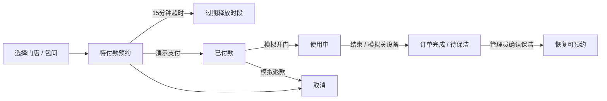

# RoomFlow · 青禾自助棋牌空间

**简体中文** | [English](README.en.md)

**单商家、多门店的自助棋牌室管理系统：用户预约、移动运营与 PC 管理共用一个 Java 后端。**

这是面向商业经营场景的个人作品，当前完成第一阶段的可运行演示。支付、退款、门锁和通电均为模拟；不能直接作为正式商用系统上线。


## 三个使用端

| 使用端 | 当前功能 |
| --- | --- |
| 用户小程序 | 门店筛选、查看包间、预约时段、演示支付、模拟开门、结束使用、取消预约 |
| 管理员小程序 | 所属门店订单、结束使用、保洁完成、维护与恢复预约 |
| PC 工作台 | 商家全店管理 / 店管理员所属店管理、包间状态、订单筛选、汇总指标、商家操作日志 |

用户与管理员共用一个原生微信小程序工程，通过后端角色决定权限。PC 也提供用户演示身份，方便在浏览器体验预约闭环。

## 预约业务闭环



- 预约冲突采用房间行锁与事务保护，同一时段并发预约仅允许一个成功。
- 价格按整数分计算；支持半小时计价，最长 12 小时，最多提前 30 天预约。
- 待付款保留 15 分钟，在查询和业务操作时清理过期订单。
- 开门仅允许在预约开始前 15 分钟至结束时间内；未付款不能开门。
- 使用结束转为待保洁；保洁后恢复可预约。
- 用户只能操作自己的订单，店管理员仅能操作所属门店；商家负责人可跨店管理。
- 设备通过 `DeviceGateway` 接口隔离，目前只有模拟适配器。真实设备的失败确认、重试与对账尚未实现。

## 本地运行

需要 JDK 8 和 Maven。演示使用本地 H2 文件数据库，无须配置 MySQL。

```powershell
cd backend
mvn clean package
cd ..
./start.ps1
```

打开 http://localhost:8091，选择“用户体验”“商家负责人”或“城南店管理员”。演示账号没有密码，只用于本地体验。测试用户 `guest2` 可通过演示登录接口用于权限验证。

设置 `ROOMFLOW_DEMO=false` 会禁用演示登录、支付与设备操作。正式认证与真实服务尚未接入，系统会拒绝相关操作。

### 微信小程序

在微信开发者工具中导入 `miniprogram` 目录。工程使用测试 AppID `touristappid`；是否可在你的工具版本中使用，需实际导入确认。

在 `miniprogram/app.js` 配置后端地址。开发机测试地址为 `http://127.0.0.1:8091`，真机需使用可访问的服务器地址。正式发布需要自己的 AppID、HTTPS 合法域名和微信登录。

服务默认只监听本机。可信局域网真机测试时可设置 `SERVER_ADDRESS`，并使用独立模拟数据；不要向公网开放演示管理员登录。

本次仅完成小程序源码与 JavaScript 语法检查，尚未在微信开发者工具或真机验收。

## 验证

```powershell
cd backend
mvn test
```

9 项业务测试通过，覆盖预约闭环、保洁、时段冲突、相邻时段、权限隔离、幂等、开门时间窗、超时释放、并发预约和禁用演示入口。PC 与小程序 JavaScript 语法检查通过。

PC 浏览器已实际走通预约、演示支付、模拟开门、结束使用、管理员保洁完成的流程。小程序尚未完成工具或真机联调。

## 技术与目录

- Java 8 / Spring Boot 2.7.18 / JDBC / H2；前端采用原生 HTML、CSS、JavaScript；小程序采用原生 WXML / WXSS / JavaScript。
- `backend`：接口、事务、角色权限、模拟设备、PC 静态资源与测试。
- `miniprogram`：用户与管理员小程序。
- `docs/PRODUCT.md`：商业版功能边界与后续建设清单。
- `.local`：本地数据库与运行日志，禁止提交。

## 当前边界

现阶段没有微信登录、真实支付、真实退款、实体设备控制、自动到时断电、续时、优惠券、会员钱包、正式账务结算或生产告警。汇总金额为演示订单金额，不是财务营收报表。多门店数据为演示初始化，暂不支持门店和包间配置页面。

后续商用需要生产数据库与迁移、正式认证、支付回调验签、金额校验、退款对账、设备回执、定时任务、日志监控、备份、部署及真机联调验收。具体阶段见 [产品规划](docs/PRODUCT.md)。
